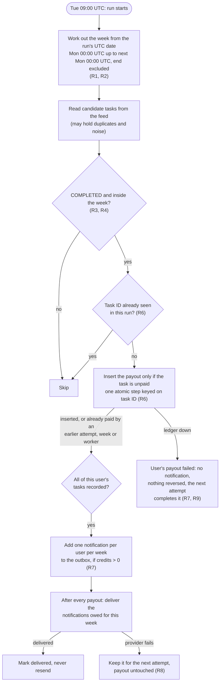
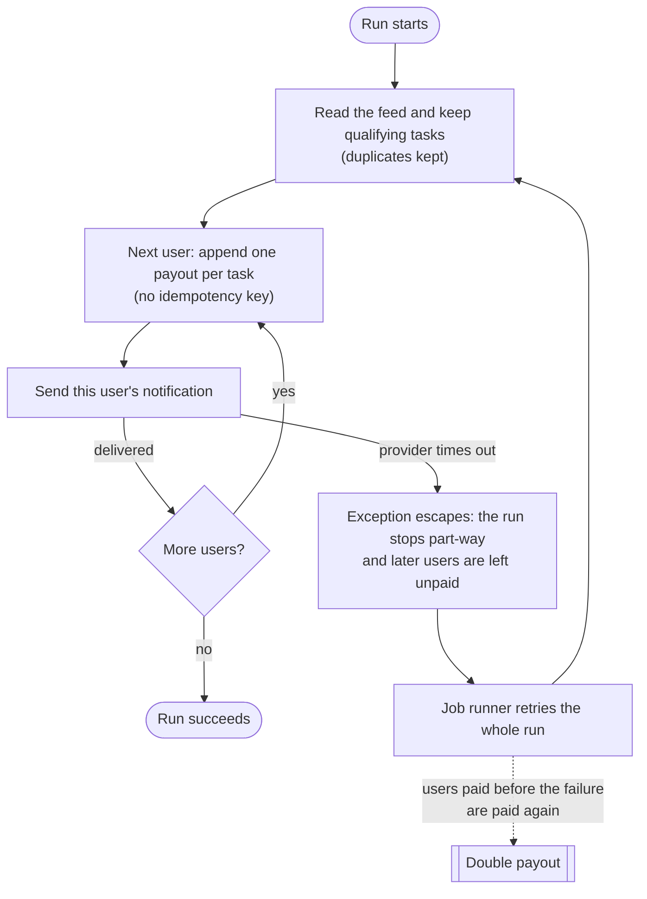

# Settlement flow

Rule numbers refer to [business-rules.md](business-rules.md).

## The fixed flow (`IdempotentSettlementJob`)

## Where the legacy flow breaks (`LegacySettlementJob`, DEF-001)

The same double payout happens without any failure when the feed delivers a task twice (TC-01), when a
week is re-run (TC-02), when a paid task reappears in a later week (TC-03), or when two workers settle the
same week at once (TC-07).
